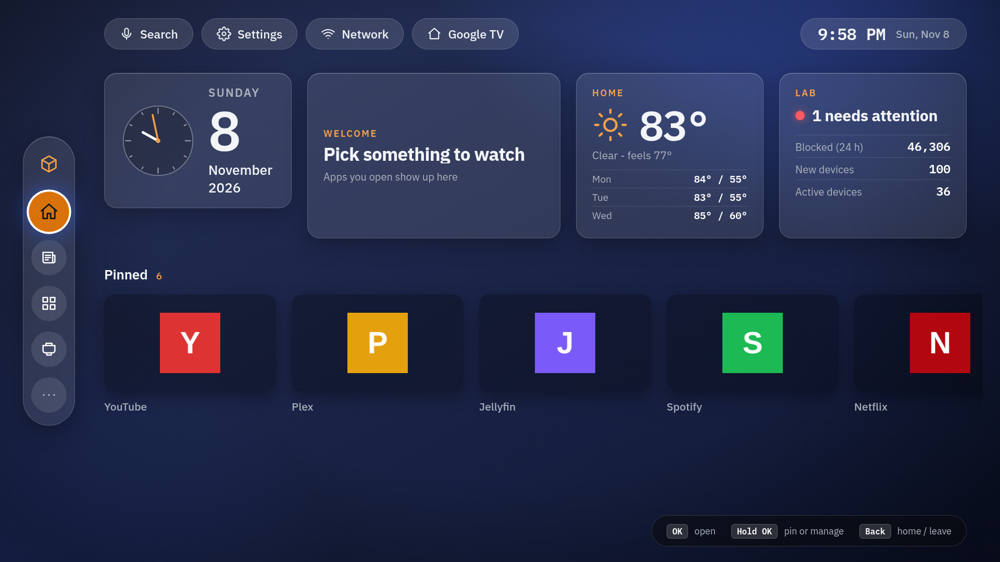
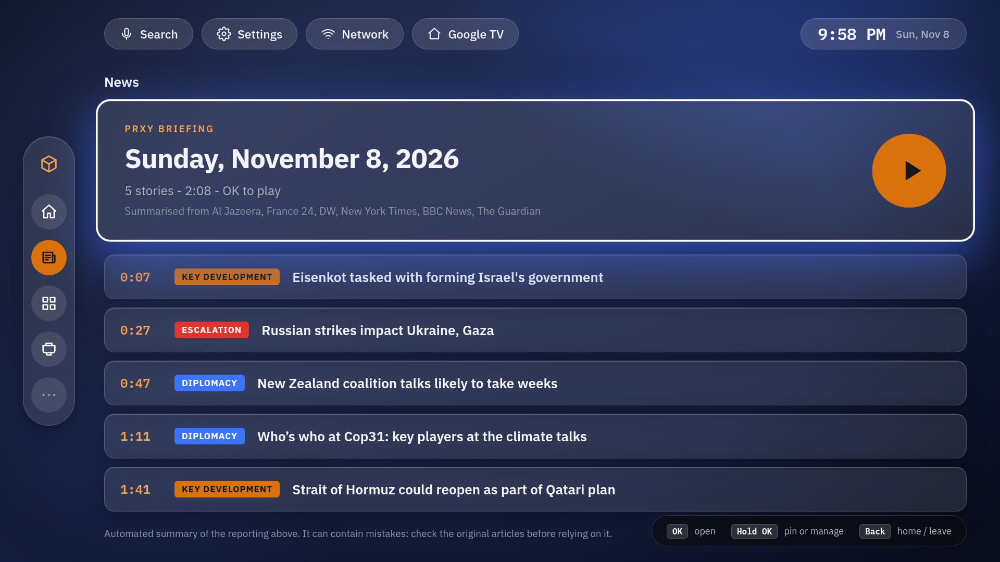
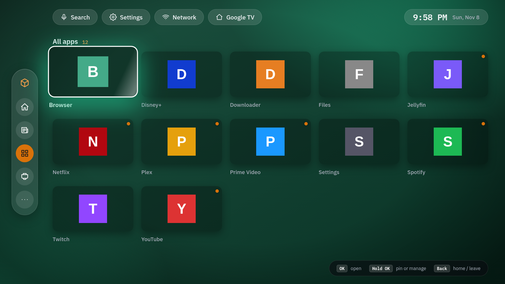
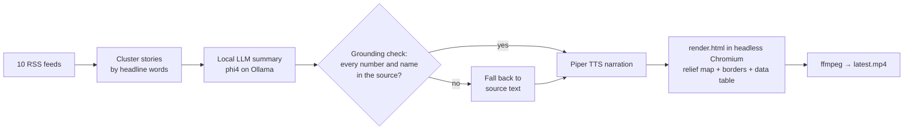

# Prxy TV + Prxy Briefing

**A custom Android TV home screen, plus a self-made daily news video, both running on my own hardware.**

> Java · Android (minSdk 26, targetSdk 34) · WebView UI (HTML/CSS/JS) · Node.js · Playwright/Chromium ·
> ffmpeg · Piper TTS · Ollama (phi4) · Python · Natural Earth map data



| News page with today's briefing | Daily briefing video frame |
|---|---|
|  |  |
| **All apps** | **Briefing intro** |
|  |  |

<sub>Launcher UI rendered at 1080p with the real lab feed (counts only). App tiles are placeholders, not real app icons.</sub>

## 1. Prxy TV launcher (`launcher/`)
A replacement home screen for a Google TV set, built to compete with the stock launcher and add homelab features.
- Side rail (Home · News · Apps · Inputs · More), glass widgets, **focus-driven accent colour**, themes
- App rows based on usage, HDMI input switching, voice-assistant chip, idle **screen saver** (`DreamService`)
- **Lab widget**: live counts from my homelab (attention items, blocked traffic, new and active devices) through a counts-only feed
- **News page** with an in-app player for the daily briefing
- An accessibility service that brings back the Home button after the system launcher takes it over
- **Locked down:** only the `INTERNET` permission, and cleartext traffic is allowed to **one** lab address
  (`network_security.xml`). The TV never talks to the internet for lab data.

```bash
cd launcher && gradle --no-daemon assembleDebug   # needs the Android SDK; sideload the APK
```

## 2. Prxy Briefing (`briefing/`)
An automated pipeline that makes a narrated, map-based world-news video every morning at 06:00.


- **Hallucination guard:** a generated summary is rejected if it contains any number or proper name
  that is not in the source articles. Sources are listed on screen for every story.
- If too few sourced stories make it through, nothing is published and yesterday's video stays.
- Fully local: summarisation and voice run on my own GPU/CPU, and the video is rendered with headless Chromium + ffmpeg.
- Map built from public-domain Natural Earth data, with comparison figures from the World Bank API (`wb.js`).

## 3. tv-feed (`tv-feed/`)
A tiny read-only Python server between the TV and the lab: it returns **counts only** (no names or addresses),
answers only an allow-list of client IPs, and serves the briefing video with HTTP Range support.

## What I learned
- Android TV internals: launchers, D-pad focus handling, DreamService, accessibility services, sideloading without ADB.
- Building a reliable media pipeline (TTS → timed audio segments → rendered frames → encoded video) that runs unattended.
- Guarding LLM output with simple, verifiable rules instead of trusting it.
- Keeping an IoT device on its own network segment and allowing it to reach only one counts-only endpoint.

Fonts: IBM Plex (SIL Open Font License, `OFL.txt`). Map data: Natural Earth (public domain).

---
*Part of my homelab portfolio. See also [homelab](https://github.com/proxy9108/homelab).*
